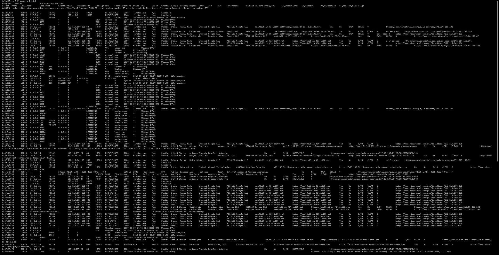

# NetScan Enriched

A [Volatility 3](https://github.com/volatilityfoundation/volatility3) plugin that extends `windows.netscan` with IP enrichment, so you can triage the network connections in a Windows memory image without copying addresses into other tools one at a time.

For every TCP listener, TCP endpoint and UDP endpoint that netscan recovers from memory, the plugin adds port service names and suspicious-port flags. On request it also adds geolocation, ISP and ASN, reverse DNS, and VirusTotal reputation for public IP addresses.



*Full enrichment run against the InCTF Internationals 2019 "Notch It Up" memory image (Windows 7 SP1 x64).*

## Features

Enrichment comes in three tiers. Tier 1 always runs; tiers 2 and 3 are opt-in because they send data to outside services.

### Tier 1: Offline analysis (always on)

- Classifies each foreign address as Public, Private-RFC1918, Loopback, Multicast, Wildcard/Any and so on
- Maps local and foreign ports to service names (443 is HTTPS, 3389 is RDP, 445 is SMB)
- Flags ports often tied to malware, C2 channels and anonymizers, such as 4444 (Metasploit default), 6667 (IRC botnet C2) and 9050 (Tor SOCKS)

### Tier 2: Geolocation and DNS (`--enrich`)

- Country, region, city, ISP and ASN from [ip-api.com](https://ip-api.com) (no API key needed)
- Reverse DNS (PTR) lookups through your system resolver, with ip-api.com's reverse field as a fallback
- Indicators for hosting or data center networks and for proxy, VPN or Tor exit addresses
- A URL hint built from the reverse DNS hostname

### Tier 3: VirusTotal threat intelligence (`--vtkey` or `VT_API_KEY`)

- Detection ratio from the VirusTotal API v3 IP address report (for example `3/87`)
- A verdict of MALICIOUS, SUSPICIOUS, CLEAN, NO_DATA or UNKNOWN (see [Verdict rules](#virustotal-verdict-rules))
- Community reputation score and tags such as `botnet` or `tor`
- A direct link to the VirusTotal report for each IP
- MALICIOUS and SUSPICIOUS hits are copied into the `Flags` column, logged as they are found, and totaled in a summary line at the end of the scan

Only public IP addresses are sent to either service, and each unique IP is looked up once per run. For each connection the plugin enriches the foreign address if it is public, and otherwise the local address if that one is public.

## Requirements

- Python 3.8 or newer
- Volatility 3 framework 2.26.0 or newer (developed and tested on 2.28.1)
- A Windows memory image that the stock `windows.netscan` plugin supports
- For tiers 2 and 3: internet access, plus a VirusTotal API key for tier 3 (a free community key works)

The plugin uses only the Python standard library on top of Volatility, so there is nothing else to install.

## Installation

1. Clone or download this repository.
2. Install Volatility 3 if you don't already have it:

   ```bash
   pip install -r requirements.txt
   ```

3. Load the plugin in one of two ways.

   **Plugin directory (recommended).** Leave the file where it is and pass the `plugins` folder with `-p`. From the repository root:

   ```bash
   vol -p plugins -f memory.raw windows.netscan_enriched.NetScanEnriched
   ```

   `-p` accepts a semicolon-separated list, so you can combine this with other plugin folders.

   **Copy into a Volatility source checkout.** Copy `plugins/windows/netscan_enriched.py` into `volatility3/framework/plugins/windows/` in your Volatility 3 checkout, then run it with `python3 vol.py` and no `-p`.

To confirm Volatility can see the plugin, print its help:

```bash
vol -p plugins windows.netscan_enriched.NetScanEnriched -h
```

## Usage

Global Volatility options such as `-f`, `-p`, `-r` and `--hide-columns` go before the plugin name. The plugin's own options go after it.

| Option | Description |
| --- | --- |
| `--enrich` | Turn on tier 2 (geolocation, ISP/ASN, reverse DNS) |
| `--vtkey KEY` | Turn on tier 3 with this VirusTotal API key. Falls back to the `VT_API_KEY` environment variable |
| `--include-corrupt` | Show partially overwritten objects, as in stock netscan. Expect some garbage |

The examples below use the `vol` command that pip installs and are run from the repository root. With a source checkout of Volatility, use `python3 vol.py` instead.

```bash
# Offline enrichment only (as long as VT_API_KEY is not set in your environment)
vol -p plugins -f memory.raw windows.netscan_enriched.NetScanEnriched

# Add geolocation, ISP/ASN and reverse DNS
vol -p plugins -f memory.raw windows.netscan_enriched.NetScanEnriched --enrich

# Add VirusTotal. Reading the key from the environment keeps it out of your shell history.
export VT_API_KEY="your-key"
vol -p plugins -f memory.raw windows.netscan_enriched.NetScanEnriched --enrich

# Or pass the key on the command line (this takes priority over VT_API_KEY)
vol -p plugins -f memory.raw windows.netscan_enriched.NetScanEnriched --enrich --vtkey YOUR_KEY

# Export to CSV for Excel, Splunk and similar tools
vol -p plugins -r csv -f memory.raw windows.netscan_enriched.NetScanEnriched --enrich > connections.csv

# Export to JSON
vol -p plugins -r json -f memory.raw windows.netscan_enriched.NetScanEnriched --enrich > connections.json

# Hide columns you don't need (case-insensitive name prefixes)
vol -p plugins --hide-columns VT_Link URLHint -f memory.raw windows.netscan_enriched.NetScanEnriched --enrich
```

VirusTotal lookups work with or without `--enrich`. In PowerShell, set the key with `$env:VT_API_KEY = "your-key"`.

With the `csv`, `json` and `jsonl` renderers, Volatility prints its banner to stderr. Progress and log messages, including the VirusTotal summary, always go to stderr, so the redirected file contains only the table.

## Output columns

The output keeps the ten stock netscan columns (Offset, Proto, LocalAddr, LocalPort, ForeignAddr, ForeignPort, State, PID, Owner, Created) and adds eighteen more, for 28 in total. In output order, the new columns are:

| Column | Tier | Description |
| --- | --- | --- |
| LocalPortSvc | 1 | Service name for the local port (placed after LocalPort) |
| ForeignPortSvc | 1 | Service name for the foreign port (placed after ForeignPort) |
| IPType | 1 | Classification of the foreign address |
| Country | 2 | Country of the enriched IP |
| Region | 2 | State or region |
| City | 2 | City |
| ISP | 2 | ISP that owns the IP |
| ASN | 2 | AS number and name, for example `AS15169 Google LLC` |
| ReverseDNS | 2 | PTR hostname |
| URLHint | 2 | `https://` link built from the reverse DNS name. A convenience, not proof that a website is served there |
| Hosting | 2 | `Yes` if ip-api.com classifies the IP as hosting, colocation or data center |
| Proxy/VPN | 2 | `Yes` if ip-api.com classifies the IP as a proxy, VPN or Tor exit |
| VT_Detections | 3 | Malicious detections over total engines, for example `1/94` |
| VT_Verdict | 3 | MALICIOUS, SUSPICIOUS, CLEAN, NO_DATA or UNKNOWN |
| VT_Reputation | 3 | VirusTotal community reputation score (negative means a bad reputation) |
| VT_Tags | 3 | VirusTotal tags |
| VT_Link | 3 | Link to the VirusTotal report for the IP |
| Flags | 1 and 3 | Suspicious ports (`L:` local, `R:` remote) and VirusTotal hits, separated by semicolons, for example `R:4444-Metasploit-Default; VT:SUSPICIOUS(1/94)` |

Columns for a tier that isn't enabled, or that don't apply to a connection, are left empty.

## VirusTotal verdict rules

| Verdict | Rule |
| --- | --- |
| MALICIOUS | 5 or more engines report the IP as malicious |
| SUSPICIOUS | 1 to 4 malicious detections, or 3 or more suspicious detections |
| CLEAN | At least one engine result, with no malicious or suspicious detections |
| NO_DATA | VirusTotal has no report for the IP (HTTP 404) |
| UNKNOWN | Anything else, such as no engine results, or 1 or 2 suspicious detections with no malicious ones |

The thresholds are deliberately conservative because a single detection is often a false positive. Treat verdicts and port flags as triage hints, and open the VirusTotal link before drawing conclusions. The thresholds live in `VirusTotalCache.lookup()` if you want to change them.

## Rate limits and run time

- **ip-api.com:** the free endpoint allows 45 requests per minute. The plugin waits 1.4 seconds between requests, so 20 unique public IPs take about 30 seconds.
- **VirusTotal:** the free public API allows 4 requests per minute and 500 per day. The plugin waits 15.5 seconds between requests, so 20 unique public IPs take about 5 minutes, and a very busy image can use up the daily quota. On HTTP 429 it pauses for 60 seconds before continuing. With a premium key you can lower `VirusTotalCache.RATE_LIMIT_DELAY`.
- **Failures:** each service shuts itself off after 5 consecutive failed lookups, and an invalid VirusTotal key (HTTP 401) shuts VirusTotal off immediately. The scan still finishes and reports whatever data it has.

## Privacy and OPSEC

Tiers 2 and 3 send information from your case to third parties, so check your handling rules before you enable them.

- `--enrich` sends each unique public IP to ip-api.com over plain HTTP, because the free endpoint does not support HTTPS.
- Reverse DNS lookups go through your system resolver and can reach name servers run by whoever controls the address range.
- VirusTotal adds the indicators you query to its dataset and asks users not to submit sensitive or confidential information.
- Neither free tier allows commercial use. ip-api.com's free endpoint is for non-commercial use only, and VirusTotal's public API may not be used in commercial products or services, or in business workflows that don't contribute new files.

Without `--enrich`, `--vtkey` or a `VT_API_KEY` environment variable, the plugin itself makes no network requests. Volatility can still go online to look for symbol files; see its `--offline` option.

## How it works

The pool-scanning code (the `TcpL`, `TcpE` and `UdpA` pool tag constraints, `tcpip.sys` symbol table selection, and the scan itself) is taken from the stock `windows.netscan` plugin. The only change to that code is a guard for Volatility builds that lack the `verinfo` plugin. Enrichment happens as each row is built, with per-run caches in front of both web services.

The plugin also implements Volatility's timeliner interface, so connection creation times show up in `timeliner` output, with any enrichment data added to each event's description.

## Testing

The plugin was tested with Volatility 3 Framework 2.28.1 against the memory image from the InCTF Internationals 2019 "Notch It Up" forensics challenge (Windows 7 SP1 x64). The [challenge writeup](https://blog.bi0s.in/2019/09/24/Forensics/InCTFi19-NotchItUp/) links to the image download.

With all three tiers enabled, the scan found 93 network objects and checked 24 unique public IPs against VirusTotal:

| Verdict | IPs |
| --- | --- |
| CLEAN | 23 |
| SUSPICIOUS | 1 |
| MALICIOUS | 0 |

The suspicious address, 117.18.237.29 (EdgeCast Networks, Phoenix, Arizona), had 1 of 94 engines flag it and appeared in three HTTP connections from `firefox.exe` (PID 2080). The other 23 public IPs, mostly Google and Amazon Web Services infrastructure, were all rated CLEAN.

## Project layout

```text
.
|-- plugins/
|   `-- windows/
|       `-- netscan_enriched.py    the plugin
|-- docs/
|   `-- images/
|       `-- sample-output.jpg      screenshot used in this README
|-- requirements.txt
|-- LICENSE
`-- README.md
```

## Authors

Ryan Godburn, Braeden Allen and Anthony Ciavarella

## License

This plugin contains code from the Volatility Foundation's `windows.netscan` plugin (Copyright 2019 Volatility Foundation), so it is distributed under the [Volatility Software License 1.0](https://www.volatilityfoundation.org/license/vsl-v1.0). See [LICENSE](LICENSE) for the full text.
